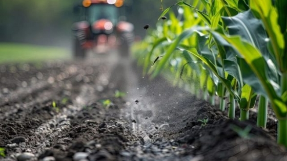

# 🌱 Modelo Racional de Fertilización NPK Avanzado

### Modelo de cálculo de requerimientos nutricionales, balance de nitrógeno, diagnóstico foliar SPAD y corrección de acidez del suelo.

---

## Descripción del proyecto

Este proyecto consiste en el desarrollo de un modelo de cálculo en Python orientado a optimizar la fertilización de cultivos mediante la integración de información del suelo, requerimientos nutricionales y parámetros del cultivo.

El modelo permite estimar las dosis de nitrógeno (N), fósforo (P₂O₅) y potasio (K₂O), considerando no solamente la disponibilidad de nutrientes en el suelo, sino también otros aportes que intervienen en el balance nutricional, como la mineralización de la materia orgánica (MOS), la incorporación de rastrojos y el nitrógeno aportado por el agua de riego.

Además, incorpora un sistema de ajuste de nitrógeno mediante mediciones de clorofila obtenidas con clorofilómetro SPAD, junto con un diagnóstico de pH para evaluar la necesidad de aplicar enmiendas calcáreas.

El propósito es desarrollar una herramienta de apoyo a la toma de decisiones agronómicas que permita realizar recomendaciones de fertilización más ajustadas a las condiciones del suelo y las necesidades del cultivo.

---

## Objetivos

- Estimar los requerimientos nutricionales de distintos cultivos.
- Calcular dosis de fertilización NPK considerando los aportes y disponibilidad de nutrientes del suelo.
- Incorporar la contribución de la materia orgánica y los residuos vegetales al suministro de nitrógeno.
- Cuantificar el aporte de nitrógeno proveniente del agua de riego.
- Ajustar la fertilización nitrogenada mediante mediciones SPAD.
- Evaluar las condiciones de acidez del suelo y estimar requerimientos de encalado.

---

## Componentes del modelo

### 1. Fertilización NPK

El modelo calcula los requerimientos de nitrógeno, fósforo y potasio según el rendimiento esperado, los índices de cosecha, los requerimientos internos de nutrientes y la disponibilidad de elementos en el suelo.

**Nutrientes considerados:**
- Nitrógeno (N).
- Fósforo (P₂O₅).
- Potasio (K₂O).

.webp")

### 2. Balance de nitrógeno

Uno de los componentes principales es la integración de diferentes fuentes de suministro de nitrógeno, permitiendo descontar sus aportes de la demanda total del cultivo.

Se consideran cuatro fuentes:

- **Nitrógeno inorgánico del suelo:** aporte proveniente del contenido de N disponible en el suelo.
- **Mineralización de MOS:** estimación del nitrógeno liberado por la mineralización de la materia orgánica.
- **Incorporación de rastrojos:** consideración del nitrógeno aportado por los residuos del cultivo anterior.
- **Nitrógeno en el agua de riego:** cuantificación del aporte de N según su concentración y volumen de agua aplicado.

El resultado permite estimar el suministro total de nitrógeno y determinar la dosis complementaria de fertilizante.

.webp")

### 3. Ajuste de nitrógeno mediante clorofilómetro SPAD

Se incorpora un sistema de diagnóstico foliar basado en lecturas SPAD, que permite comparar el estado de clorofila del cultivo con un valor de referencia específico para cada especie.

El modelo calcula el porcentaje de suficiencia SPAD y aplica un factor de corrección sobre la dosis base de nitrógeno:

- **Suficiencia inferior al 95%:** incrementa la dosis de nitrógeno proporcionalmente al déficit observado.
- **Suficiencia entre 95% y 105%:** mantiene la dosis base.
- **Suficiencia superior al 105%:** aplica un factor de reducción de 0,90.

De esta manera, se incorpora una evaluación del estado nutricional de la planta para complementar la recomendación basada en el análisis de suelo.

### 4. Diagnóstico de pH y requerimientos de encalado

El modelo compara el pH del suelo con un valor crítico definido para cada cultivo.

Cuando el pH se encuentra por debajo del valor crítico, estima una dosis de cal agrícola mediante una capacidad tampón de pH definida como parámetro de entrada.

También identifica condiciones de alcalinidad cuando el pH supera 7,8, considerando el posible riesgo de fijación de fósforo.

---

## Cultivos incorporados

El código contempla una base de parámetros para cultivos tradicionales y hortalizas.

**Cultivos tradicionales:**
- Trigo
- Maravilla
- Cebada
- Frejoles
- Garbanzos
- Arvejas
- Lentejas
- Arroz
- Maíz
- Raps
- Remolacha
- Papas
- Ballica italiana
- Avena

**Hortalizas y otros:**
- Acelga
- Cebolla
- Lechuga
- Melón
- Tomate
- Zapallo
- Lúpulo
- Zanahoria
- Brócoli
- Coliflor
- Pepino
- Pimiento
- Berenjena
- Sandía

Cada cultivo cuenta con parámetros específicos, entre ellos índice de cosecha, humedad de cosecha, requerimientos internos de nutrientes, pH crítico y referencia SPAD.

---

## Variables de entrada

| Categoría | Parámetros |
|---|---|
| Cultivo | Especie y rendimiento esperado |
| Suelo | N, P y K disponibles |
| Propiedades físicas | Densidad aparente y profundidad de muestreo |
| Fertilización | Eficiencia de N y K |
| Materia orgánica | MOS y tasa de mineralización |
| Rastrojos | Incorporación, toneladas y contenido de N |
| Agua de riego | Concentración de N y volumen aplicado |
| Diagnóstico foliar | Lectura SPAD del sector |
| Acidez | pH y capacidad tampón |

---

## Resultados del modelo

El programa entrega un resumen de los cálculos realizados, incluyendo:

- Demanda total de N, P y K.
- Aporte de nitrógeno del suelo.
- Nitrógeno proveniente de la mineralización de MOS.
- Aporte de nitrógeno por incorporación de rastrojos.
- Aporte de nitrógeno del agua de riego.
- Suministro total de nitrógeno.
- Dosis base y dosis ajustada de nitrógeno mediante SPAD.
- Dosis recomendada de P₂O₅ y K₂O.
- Diagnóstico del pH.
- Dosis estimada de cal agrícola.

---

## Tecnologías utilizadas

- **Python:** desarrollo del modelo y automatización de cálculos.
- **Funciones y diccionarios:** organización de parámetros por cultivo y ejecución de los cálculos.
- **Modelación agronómica:** integración de parámetros de fertilidad de suelo y nutrición vegetal.

---

## Referencias bibliográficas

- Havlin, J. L., Tisdale, S. L., Nelson, W. L., & Beaton, J. D. (2014). *Soil fertility and fertilizers: An introduction* (8th ed.). Pearson.
- Marschner, P. (Ed.). (2012). *Marschner's mineral nutrition of higher plants* (3rd ed.). Academic Press. https://doi.org/10.1016/C2009-0-63043-9
- Food and Agriculture Organization of the United Nations. (2006). *Plant nutrition for food security: A guide for integrated nutrient management* (FAO Fertilizer and Plant Nutrition Bulletin No. 16). https://www.fao.org/4/a0443e/a0443e00.htm

---

## Proyección del proyecto

Se busca avanzar hacia un modelo de recomendación nutricional que integre progresivamente información de suelo, agua y planta, permitiendo mejorar la precisión de los cálculos y facilitar la toma de decisiones en el manejo de la fertilización agrícola.

